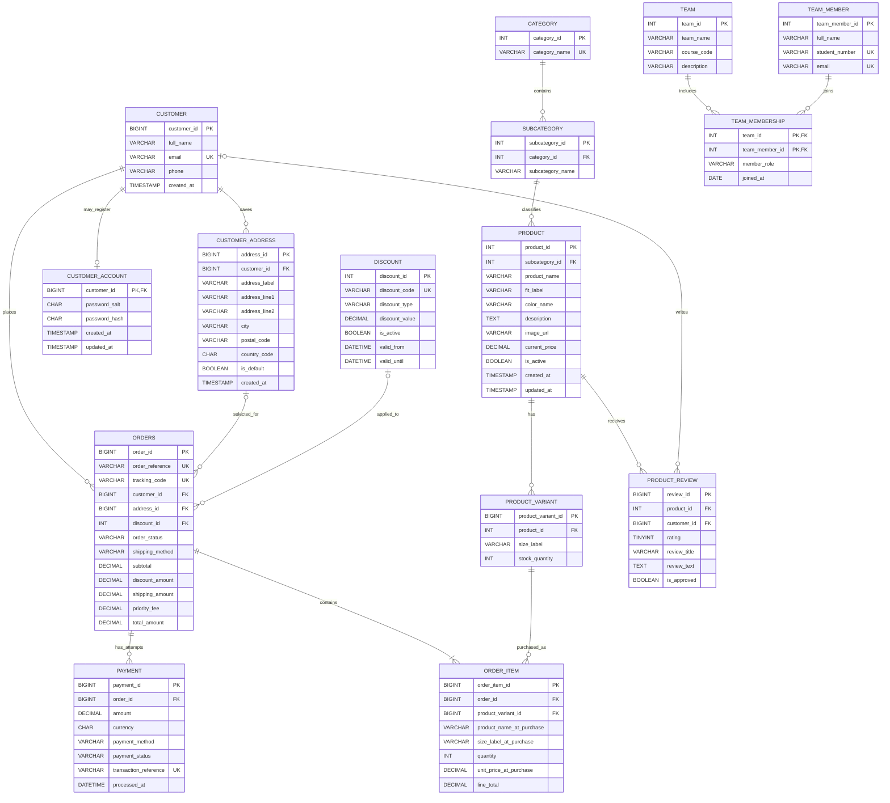

# INFS 222 Database Assignment Report

## AllFit Fashion E-commerce Database

**Database:** `allfit_fashion`

**DBMS:** MySQL 8.0.16 or later

**Storage engine:** InnoDB

**Character set and collation:** `utf8mb4`, `utf8mb4_unicode_ci`
**Implementation script:** [`schema.sql`](./schema.sql)

> **Scope and sample-data note:** This report documents the schema currently defined in `database/schema.sql`. The script seeds the three catalogue departments, their 19 subcategories, all 100 products (IDs 1–100), and their product-size variants, matching `public_html/js/catalogue.js`. Seeded product colours are deterministic placeholders, not verified garment colours. Customer, team, order, payment, and review records are clearly fictional demonstration data. Replace the sample team members with the real team details before submitting the database.

> **Execution status:** The script is provided for MySQL Workbench, but it has not been successfully executed against the local MySQL server. The local server denied the previous `root` connection without a password. Therefore, this report does not claim that the database has been installed or tested.

---

## Task 1 — Relational schema notation

Notation: `PK` = primary key; `FK` = foreign key; `UQ` = unique key; `NN` = not null; `AI` = auto-increment; `DF` = default; `G` = generated stored column. SQL types and the actual key structure are the ones declared in `schema.sql`.

```text
CATEGORY(
  category_id INT UNSIGNED PK AI,
  category_name VARCHAR(40) NN UQ
)

SUBCATEGORY(
  subcategory_id INT UNSIGNED PK AI,
  category_id INT UNSIGNED NN FK -> CATEGORY.category_id,
  subcategory_name VARCHAR(60) NN,
  UQ(category_id, subcategory_name)
)

PRODUCT(
  product_id INT UNSIGNED PK,
  subcategory_id INT UNSIGNED NN FK -> SUBCATEGORY.subcategory_id,
  product_name VARCHAR(160) NN,
  fit_label VARCHAR(40) NN DF 'Regular',
  color_name VARCHAR(40) NN DF 'Assorted',
  description TEXT NN,
  image_url VARCHAR(600) NN,
  current_price DECIMAL(10,2) NN,
  is_active BOOLEAN NN DF TRUE,
  created_at TIMESTAMP NN DF CURRENT_TIMESTAMP,
  updated_at TIMESTAMP NN DF CURRENT_TIMESTAMP ON UPDATE CURRENT_TIMESTAMP
)

PRODUCT_VARIANT(
  product_variant_id BIGINT UNSIGNED PK AI,
  product_id INT UNSIGNED NN FK -> PRODUCT.product_id,
  size_label VARCHAR(20) NN,
  stock_quantity INT UNSIGNED NN DF 0,
  UQ(product_id, size_label)
)

CUSTOMER(
  customer_id BIGINT UNSIGNED PK AI,
  full_name VARCHAR(120) NN,
  email VARCHAR(254) NN UQ,
  phone VARCHAR(40) NN,
  created_at TIMESTAMP NN DF CURRENT_TIMESTAMP
)

CUSTOMER_ACCOUNT(
  customer_id BIGINT UNSIGNED PK/FK -> CUSTOMER.customer_id,
  password_salt CHAR(24) NN,
  password_hash CHAR(64) NN,
  created_at TIMESTAMP NN DF CURRENT_TIMESTAMP,
  updated_at TIMESTAMP NN DF CURRENT_TIMESTAMP ON UPDATE CURRENT_TIMESTAMP
)

CUSTOMER_ADDRESS(
  address_id BIGINT UNSIGNED PK AI,
  customer_id BIGINT UNSIGNED NN FK -> CUSTOMER.customer_id,
  address_label VARCHAR(40) NN DF 'Delivery',
  address_line1 VARCHAR(200) NN,
  address_line2 VARCHAR(200) NULL,
  city VARCHAR(100) NN,
  postal_code VARCHAR(20) NN,
  country_code CHAR(2) NN DF 'ZA',
  is_default BOOLEAN NN DF FALSE,
  created_at TIMESTAMP NN DF CURRENT_TIMESTAMP
)

DISCOUNT(
  discount_id INT UNSIGNED PK AI,
  discount_code VARCHAR(40) NN UQ,
  discount_type VARCHAR(20) NN,
  discount_value DECIMAL(7,2) NN,
  is_active BOOLEAN NN DF TRUE,
  valid_from DATETIME NULL,
  valid_until DATETIME NULL
)

ORDERS(
  order_id BIGINT UNSIGNED PK AI,
  order_reference VARCHAR(24) NN UQ,
  tracking_code VARCHAR(20) NN UQ,
  customer_id BIGINT UNSIGNED NN FK -> CUSTOMER.customer_id,
  address_id BIGINT UNSIGNED NULL FK -> CUSTOMER_ADDRESS.address_id,
  discount_id INT UNSIGNED NULL FK -> DISCOUNT.discount_id,
  discount_code_at_purchase VARCHAR(40) NULL,
  order_status VARCHAR(24) NN DF 'pending',
  shipping_method VARCHAR(16) NN DF 'normal',
  currency CHAR(3) NN DF 'ZAR',
  shipping_full_name VARCHAR(120) NN,
  shipping_email VARCHAR(254) NN,
  shipping_phone VARCHAR(40) NN,
  shipping_address_line1 VARCHAR(200) NN,
  shipping_address_line2 VARCHAR(200) NULL,
  shipping_city VARCHAR(100) NN,
  shipping_postal_code VARCHAR(20) NN,
  shipping_country_code CHAR(2) NN DF 'ZA',
  subtotal DECIMAL(12,2) NN,
  discount_amount DECIMAL(12,2) NN DF 0.00,
  shipping_amount DECIMAL(12,2) NN DF 0.00,
  priority_fee DECIMAL(12,2) NN DF 0.00,
  total_amount DECIMAL(12,2) NN,
  placed_at DATETIME NN DF CURRENT_TIMESTAMP,
  updated_at TIMESTAMP NN DF CURRENT_TIMESTAMP ON UPDATE CURRENT_TIMESTAMP
)

ORDER_ITEM(
  order_item_id BIGINT UNSIGNED PK AI,
  order_id BIGINT UNSIGNED NN FK -> ORDERS.order_id,
  product_variant_id BIGINT UNSIGNED NN FK -> PRODUCT_VARIANT.product_variant_id,
  product_name_at_purchase VARCHAR(160) NN,
  size_label_at_purchase VARCHAR(20) NN,
  quantity INT UNSIGNED NN,
  unit_price_at_purchase DECIMAL(10,2) NN,
  line_total DECIMAL(12,2) G = quantity * unit_price_at_purchase,
  UQ(order_id, product_variant_id)
)

PAYMENT(
  payment_id BIGINT UNSIGNED PK AI,
  order_id BIGINT UNSIGNED NN FK -> ORDERS.order_id,
  amount DECIMAL(12,2) NN,
  currency CHAR(3) NN DF 'ZAR',
  payment_method VARCHAR(24) NN,
  payment_status VARCHAR(24) NN DF 'pending',
  provider_name VARCHAR(80) NULL,
  transaction_reference VARCHAR(120) NULL UQ,
  processed_at DATETIME NULL,
  created_at TIMESTAMP NN DF CURRENT_TIMESTAMP
)

PRODUCT_REVIEW(
  review_id BIGINT UNSIGNED PK AI,
  product_id INT UNSIGNED NN FK -> PRODUCT.product_id,
  customer_id BIGINT UNSIGNED NULL FK -> CUSTOMER.customer_id,
  rating TINYINT UNSIGNED NN,
  review_title VARCHAR(120) NULL,
  review_text TEXT NULL,
  is_approved BOOLEAN NN DF FALSE,
  created_at TIMESTAMP NN DF CURRENT_TIMESTAMP,
  UQ(customer_id, product_id)
)

TEAM(
  team_id INT UNSIGNED PK AI,
  team_name VARCHAR(120) NN,
  course_code VARCHAR(30) NN DF 'INFS 222',
  description VARCHAR(255) NULL,
  created_at TIMESTAMP NN DF CURRENT_TIMESTAMP,
  UQ(course_code, team_name)
)

TEAM_MEMBER(
  team_member_id INT UNSIGNED PK AI,
  full_name VARCHAR(120) NN,
  student_number VARCHAR(40) NULL UQ,
  email VARCHAR(254) NULL UQ
)

TEAM_MEMBERSHIP(
  team_id INT UNSIGNED PK/FK -> TEAM.team_id,
  team_member_id INT UNSIGNED PK/FK -> TEAM_MEMBER.team_member_id,
  member_role VARCHAR(60) NN DF 'Member',
  joined_at DATE NN DF CURRENT_DATE,
  PK(team_id, team_member_id)
)
```

The schema uses surrogate primary keys for entities, except `team_membership`, which uses a composite primary key to ensure a member can be linked to a team only once. Product IDs are explicitly supplied so the first ten IDs match the current catalogue. `product_variant` has a surrogate primary key and a candidate unique key on `(product_id, size_label)`.

---

## Task 2 — Business rules and data dictionary

### 2.1 Business rules

1. Each category has a unique name. A subcategory belongs to exactly one category, and its name must be unique within that category.
2. Each product belongs to exactly one subcategory. Product IDs are supplied by the catalogue; the database does not auto-generate them.
3. A product may have zero or more variants. A variant belongs to exactly one product, and a product may not have duplicate size labels.
4. Variant stock is a nonnegative integer. A variant’s stock represents the available quantity for that product and size.
5. Customer email addresses are unique. Customer addresses belong to exactly one customer.
6. An order belongs to exactly one customer. Its saved address and discount are optional references.
7. An order copies delivery contact and address fields into the order row. These values are historical snapshots, so changing a customer’s address later does not alter the order’s stored delivery details.
8. Order status is limited to `pending`, `confirmed`, `processing`, `shipped`, `delivered`, `cancelled`, or `refunded`. Shipping method is `normal` or `priority`.
9. Order amounts use `DECIMAL`, must be nonnegative, and are constrained so `total_amount = subtotal - discount_amount + shipping_amount + priority_fee`.
10. Each order item references a product variant and records the product name, size, and unit price at purchase time. Quantity is from 1 through 99. `line_total` is a generated stored value equal to quantity multiplied by purchase-time unit price.
11. An order may have multiple payment records (for example, multiple attempts). Payments have a positive amount and a supported payment method/status. Transaction references, when supplied, must be unique.
12. A discount code is unique. Percentage discounts are greater than zero and at most 100; fixed-amount discounts are greater than zero. If both validity dates exist, the end must be after the start.
13. Product-review ratings are integers from 1 through 5. A review may be anonymous (`customer_id` NULL); a customer may have at most one review per product, subject to MySQL's nullable unique-key behavior.
14. Team names are unique within a course. Team membership is many-to-many, represented by `team_membership`; its composite primary key prevents duplicate membership links.
15. Sample customer, member, order and payment records are fictional. The demo payment row is not evidence of a real charge. Card numbers and CVVs are not stored.

### 2.2 Data dictionary

Types below are the declared MySQL types. `NN` means `NOT NULL`; `NULL` means nullable. Defaults, key status, and generated-column formulas are included where applicable.

#### `category`

| Column | Type | Null/default | Key / meaning |
|---|---|---|---|
| `category_id` | `INT UNSIGNED` | NN, auto-increment | PK; department identifier |
| `category_name` | `VARCHAR(40)` | NN | UQ; department name |

#### `subcategory`

| Column | Type | Null/default | Key / meaning |
|---|---|---|---|
| `subcategory_id` | `INT UNSIGNED` | NN, auto-increment | PK; subcategory identifier |
| `category_id` | `INT UNSIGNED` | NN | FK to `category.category_id` |
| `subcategory_name` | `VARCHAR(60)` | NN | Name; unique together with `category_id` |

#### `product`

| Column | Type | Null/default | Key / meaning |
|---|---|---|---|
| `product_id` | `INT UNSIGNED` | NN, supplied | PK; catalogue product ID |
| `subcategory_id` | `INT UNSIGNED` | NN | FK to `subcategory.subcategory_id` |
| `product_name` | `VARCHAR(160)` | NN | Catalogue name |
| `fit_label` | `VARCHAR(40)` | NN, `Regular` | Fit/category label |
| `color_name` | `VARCHAR(40)` | NN, `Assorted` | Colour displayed and used by catalogue filtering |
| `description` | `TEXT` | NN | Product description |
| `image_url` | `VARCHAR(600)` | NN | Product image URL |
| `current_price` | `DECIMAL(10,2)` | NN | Current unit price; must be nonnegative |
| `is_active` | `BOOLEAN` | NN, `TRUE` | Whether product is offered |
| `created_at` | `TIMESTAMP` | NN, current timestamp | Creation time |
| `updated_at` | `TIMESTAMP` | NN, current timestamp on update | Last update time |

#### `product_variant`

| Column | Type | Null/default | Key / meaning |
|---|---|---|---|
| `product_variant_id` | `BIGINT UNSIGNED` | NN, auto-increment | PK; product-size variant ID |
| `product_id` | `INT UNSIGNED` | NN | FK to `product.product_id` |
| `size_label` | `VARCHAR(20)` | NN | Size value; unique per product |
| `stock_quantity` | `INT UNSIGNED` | NN, `0` | On-hand quantity; nonnegative |

#### `customer`

| Column | Type | Null/default | Key / meaning |
|---|---|---|---|
| `customer_id` | `BIGINT UNSIGNED` | NN, auto-increment | PK; customer identifier |
| `full_name` | `VARCHAR(120)` | NN | Customer name |
| `email` | `VARCHAR(254)` | NN | UQ; customer email |
| `phone` | `VARCHAR(40)` | NN | Customer telephone |
| `created_at` | `TIMESTAMP` | NN, current timestamp | Record creation time |

#### `customer_account`

| Column | Type | Null/default | Key / meaning |
|---|---|---|---|
| `customer_id` | `BIGINT UNSIGNED` | NN | PK and FK to `customer.customer_id` |
| `password_salt` | `CHAR(24)` | NN | Per-account random salt for PBKDF2 password hashing |
| `password_hash` | `CHAR(64)` | NN | 256-bit PBKDF2-HMAC-SHA256 hash; raw password is never stored |
| `created_at` | `TIMESTAMP` | NN, current timestamp | Account registration time |
| `updated_at` | `TIMESTAMP` | NN, current timestamp on update | Last account credential update |

Registered accounts are linked one-to-one with `customer`; a customer created only by guest checkout has no `customer_account` row. The admin list combines both groups and never exposes password hashes. Password reset for database accounts is not enabled because email verification is not configured.

#### `customer_address`

| Column | Type | Null/default | Key / meaning |
|---|---|---|---|
| `address_id` | `BIGINT UNSIGNED` | NN, auto-increment | PK; saved-address identifier |
| `customer_id` | `BIGINT UNSIGNED` | NN | FK to `customer.customer_id` |
| `address_label` | `VARCHAR(40)` | NN, `Delivery` | Customer label for address |
| `address_line1` | `VARCHAR(200)` | NN | Street and number |
| `address_line2` | `VARCHAR(200)` | NULL | Optional apartment/unit |
| `city` | `VARCHAR(100)` | NN | City |
| `postal_code` | `VARCHAR(20)` | NN | Postal code |
| `country_code` | `CHAR(2)` | NN, `ZA` | Two-letter country code |
| `is_default` | `BOOLEAN` | NN, `FALSE` | Whether default address |
| `created_at` | `TIMESTAMP` | NN, current timestamp | Record creation time |

#### `discount`

| Column | Type | Null/default | Key / meaning |
|---|---|---|---|
| `discount_id` | `INT UNSIGNED` | NN, auto-increment | PK; discount identifier |
| `discount_code` | `VARCHAR(40)` | NN | UQ; code entered at checkout |
| `discount_type` | `VARCHAR(20)` | NN | `percentage` or `fixed_amount` |
| `discount_value` | `DECIMAL(7,2)` | NN | Rate or amount, depending on type |
| `is_active` | `BOOLEAN` | NN, `TRUE` | Whether code is active |
| `valid_from` | `DATETIME` | NULL | Optional start date/time |
| `valid_until` | `DATETIME` | NULL | Optional end date/time |

#### `orders`

| Column | Type | Null/default | Key / meaning |
|---|---|---|---|
| `order_id` | `BIGINT UNSIGNED` | NN, auto-increment | PK; internal order identifier |
| `order_reference` | `VARCHAR(24)` | NN | UQ; customer-facing reference |
| `tracking_code` | `VARCHAR(20)` | NN | UQ; randomly generated customer tracking code |
| `customer_id` | `BIGINT UNSIGNED` | NN | FK to `customer.customer_id` |
| `address_id` | `BIGINT UNSIGNED` | NULL | Optional FK to `customer_address.address_id` |
| `discount_id` | `INT UNSIGNED` | NULL | Optional FK to `discount.discount_id` |
| `discount_code_at_purchase` | `VARCHAR(40)` | NULL | Discount-code snapshot |
| `order_status` | `VARCHAR(24)` | NN, `pending` | Order lifecycle status |
| `shipping_method` | `VARCHAR(16)` | NN, `normal` | `normal` or `priority` |
| `currency` | `CHAR(3)` | NN, `ZAR` | Three-letter currency code |
| `shipping_full_name` | `VARCHAR(120)` | NN | Recipient name snapshot |
| `shipping_email` | `VARCHAR(254)` | NN | Contact email snapshot |
| `shipping_phone` | `VARCHAR(40)` | NN | Contact telephone snapshot |
| `shipping_address_line1` | `VARCHAR(200)` | NN | Street snapshot |
| `shipping_address_line2` | `VARCHAR(200)` | NULL | Optional unit snapshot |
| `shipping_city` | `VARCHAR(100)` | NN | City snapshot |
| `shipping_postal_code` | `VARCHAR(20)` | NN | Postal-code snapshot |
| `shipping_country_code` | `CHAR(2)` | NN, `ZA` | Two-letter country snapshot |
| `subtotal` | `DECIMAL(12,2)` | NN | Items subtotal |
| `discount_amount` | `DECIMAL(12,2)` | NN, `0.00` | Discount applied |
| `shipping_amount` | `DECIMAL(12,2)` | NN, `0.00` | Shipping charge |
| `priority_fee` | `DECIMAL(12,2)` | NN, `0.00` | Priority-shipping fee |
| `total_amount` | `DECIMAL(12,2)` | NN | Final amount, constrained to the amount formula |
| `placed_at` | `DATETIME` | NN, current timestamp | Order date/time |
| `updated_at` | `TIMESTAMP` | NN, current timestamp on update | Last order update time |

#### `order_item`

| Column | Type | Null/default | Key / meaning |
|---|---|---|---|
| `order_item_id` | `BIGINT UNSIGNED` | NN, auto-increment | PK; order-line identifier |
| `order_id` | `BIGINT UNSIGNED` | NN | FK to `orders.order_id` |
| `product_variant_id` | `BIGINT UNSIGNED` | NN | FK to `product_variant.product_variant_id` |
| `product_name_at_purchase` | `VARCHAR(160)` | NN | Product-name snapshot |
| `size_label_at_purchase` | `VARCHAR(20)` | NN | Size snapshot |
| `quantity` | `INT UNSIGNED` | NN | Ordered units; 1–99 |
| `unit_price_at_purchase` | `DECIMAL(10,2)` | NN | Purchase-time unit price |
| `line_total` | `DECIMAL(12,2)` | Generated stored | `quantity * unit_price_at_purchase` |

#### `payment`

| Column | Type | Null/default | Key / meaning |
|---|---|---|---|
| `payment_id` | `BIGINT UNSIGNED` | NN, auto-increment | PK; payment-attempt identifier |
| `order_id` | `BIGINT UNSIGNED` | NN | FK to `orders.order_id` |
| `amount` | `DECIMAL(12,2)` | NN | Attempt/transaction amount; greater than zero |
| `currency` | `CHAR(3)` | NN, `ZAR` | Three-letter currency code |
| `payment_method` | `VARCHAR(24)` | NN | `demo`, `card`, `eft`, `cash`, or `other` |
| `payment_status` | `VARCHAR(24)` | NN, `pending` | Attempt status, including `mock_approved` |
| `provider_name` | `VARCHAR(80)` | NULL | Optional payment provider |
| `transaction_reference` | `VARCHAR(120)` | NULL | Optional unique provider reference |
| `processed_at` | `DATETIME` | NULL | Optional processing time |
| `created_at` | `TIMESTAMP` | NN, current timestamp | Attempt creation time |

#### `product_review`

| Column | Type | Null/default | Key / meaning |
|---|---|---|---|
| `review_id` | `BIGINT UNSIGNED` | NN, auto-increment | PK; review identifier |
| `product_id` | `INT UNSIGNED` | NN | FK to `product.product_id` |
| `customer_id` | `BIGINT UNSIGNED` | NULL | Optional FK to `customer.customer_id` |
| `rating` | `TINYINT UNSIGNED` | NN | Rating from 1 through 5 |
| `review_title` | `VARCHAR(120)` | NULL | Optional title |
| `review_text` | `TEXT` | NULL | Optional review text |
| `is_approved` | `BOOLEAN` | NN, `FALSE` | Moderation status |
| `created_at` | `TIMESTAMP` | NN, current timestamp | Review creation time |

#### `team`

| Column | Type | Null/default | Key / meaning |
|---|---|---|---|
| `team_id` | `INT UNSIGNED` | NN, auto-increment | PK; team identifier |
| `team_name` | `VARCHAR(120)` | NN | Team name |
| `course_code` | `VARCHAR(30)` | NN, `INFS 222` | Course identifier |
| `description` | `VARCHAR(255)` | NULL | Optional team description |
| `created_at` | `TIMESTAMP` | NN, current timestamp | Team creation time |

#### `team_member`

| Column | Type | Null/default | Key / meaning |
|---|---|---|---|
| `team_member_id` | `INT UNSIGNED` | NN, auto-increment | PK; person identifier |
| `full_name` | `VARCHAR(120)` | NN | Member's name |
| `student_number` | `VARCHAR(40)` | NULL | Optional UQ student number |
| `email` | `VARCHAR(254)` | NULL | Optional UQ email |

#### `team_membership`

| Column | Type | Null/default | Key / meaning |
|---|---|---|---|
| `team_id` | `INT UNSIGNED` | NN | PK component; FK to `team.team_id` |
| `team_member_id` | `INT UNSIGNED` | NN | PK component; FK to `team_member.team_member_id` |
| `member_role` | `VARCHAR(60)` | NN, `Member` | Role on the team |
| `joined_at` | `DATE` | NN, current date | Membership start date |

---

## Task 3 — System catalog

### 3.1 Logical catalog

| Table | Purpose | Primary key | Main foreign keys |
|---|---|---|---|
| `category` | Product departments | `category_id` | — |
| `subcategory` | Department-specific product grouping | `subcategory_id` | `category_id` |
| `product` | Catalogue product details/current price | `product_id` | `subcategory_id` |
| `product_variant` | Product size and available stock | `product_variant_id` | `product_id` |
| `customer` | Customer contact details | `customer_id` | — |
| `customer_account` | Registered account credentials, stored as salted password hashes | `customer_id` | `customer_id` |
| `customer_address` | Reusable customer delivery addresses | `address_id` | `customer_id` |
| `discount` | Discount code and rule | `discount_id` | — |
| `orders` | Order header, delivery snapshot, and monetary summary | `order_id` | `customer_id`, optional `address_id`, optional `discount_id` |
| `order_item` | Purchased variants, quantity, and purchase-time price snapshots | `order_item_id` | `order_id`, `product_variant_id` |
| `payment` | Payment attempts and transaction details | `payment_id` | `order_id` |
| `product_review` | Product rating/review and moderation state | `review_id` | `product_id`, optional `customer_id` |
| `team` | Assignment/project team | `team_id` | — |
| `team_member` | Student/member identity | `team_member_id` | — |
| `team_membership` | Team-to-member associative relation | `(team_id, team_member_id)` | `team_id`, `team_member_id` |

### 3.2 MySQL `INFORMATION_SCHEMA` inspection queries

After running the schema, select `allfit_fashion` and use these catalog queries to inspect the actual installed objects.

```sql
USE allfit_fashion;

-- Tables, engines, and approximate row counts.
SELECT
    table_name,
    engine,
    table_rows
FROM information_schema.tables
WHERE table_schema = DATABASE()
  AND table_type = 'BASE TABLE'
ORDER BY table_name;

-- Columns, types, nullability, defaults, and key metadata.
SELECT
    table_name,
    ordinal_position,
    column_name,
    column_type,
    is_nullable,
    column_default,
    column_key,
    extra
FROM information_schema.columns
WHERE table_schema = DATABASE()
ORDER BY table_name, ordinal_position;

-- Foreign key relationships and referential actions.
SELECT
    table_name,
    column_name,
    constraint_name,
    referenced_table_name,
    referenced_column_name
FROM information_schema.key_column_usage
WHERE table_schema = DATABASE()
  AND referenced_table_name IS NOT NULL
ORDER BY table_name, constraint_name, ordinal_position;

-- Declared table constraints.
SELECT
    table_name,
    constraint_name,
    constraint_type
FROM information_schema.table_constraints
WHERE constraint_schema = DATABASE()
ORDER BY table_name, constraint_type, constraint_name;
```

`information_schema.tables.table_rows` is an estimate for InnoDB, not a guaranteed exact row count. Use `SELECT COUNT(*) FROM table_name` when an exact count is required.

---

## Task 4 — Normalised ERD and normalisation

### 4.1 Mermaid ERD source

The following Mermaid ER diagram describes the table relationships and cardinalities declared by the SQL foreign keys. Paste the source into a Mermaid-enabled Markdown preview or Mermaid Live Editor to render it.



**Cardinality notes**

- `||` means exactly one; `o{` means zero or many; `|{` means one or many; `o|` means zero or one.
- Each `subcategory` has one category; a category can have zero or many subcategories.
- Each `product` has one subcategory; a subcategory can have zero or many products.
- Each variant belongs to exactly one product. A product can have zero or many variants.
- Each order belongs to exactly one customer. A customer can place zero or many orders.
- Each registered account belongs to exactly one customer; a customer may have zero or one registered account.
- An order's saved-address link and discount link are optional. The order’s delivery snapshot fields remain required regardless.
- Each order item belongs to exactly one order and one product variant. The order-item relation has at least one row per order in the intended ordering process, but the database DDL itself does not enforce that minimum.
- A payment belongs to one order; an order can have zero or many payment attempts.
- Team and member have a many-to-many relationship through `team_membership`.

### 4.2 First, second, and third normal forms

**First Normal Form (1NF).** Every table has a primary key and stores scalar values in each column. Repeating size values are not stored as a comma-separated field: each product-size-stock combination is its own `product_variant` row. Multiple products in one order are represented as separate `order_item` rows. Team membership is represented by rows in `team_membership`.

**Second Normal Form (2NF).** Tables with single-column primary keys have no partial dependency on a part of a key. In `team_membership`, whose primary key is `(team_id, team_member_id)`, `member_role` and `joined_at` describe that particular membership, rather than depending on only the team or only the member. Team and member attributes remain in their own entity tables.

**Third Normal Form (3NF).** Descriptive attributes are stored with their owning entities: category names are in `category`, subcategory names in `subcategory`, product descriptions in `product`, and customer contact details in `customer`. The order points to customer, address, and discount records rather than copying their current master values as the only source of truth. The order also intentionally retains delivery and discount-code snapshots for historical accuracy. Likewise, `order_item` intentionally stores product name, size, and unit price snapshots so a later catalogue edit does not rewrite what was purchased. These are deliberate transaction-history snapshots, not the current product master data.

`line_total` is generated from quantity and purchase-time unit price. Order totals are stored as checkout snapshots and constrained to their component formula. They can also be recalculated in reporting queries to verify consistency.

---

## Task 5 — MySQL implementation and executable test queries

### 5.1 Requirements and Workbench steps

The script targets **MySQL 8.0.16 or later** because it relies on enforced `CHECK` constraints, generated stored columns, and CTE syntax in a test query.

1. Open MySQL Workbench and connect to a local MySQL server using an account authorized to create databases and tables.
2. Choose **File → Open SQL Script** and open `database/schema.sql`.
3. Review the sample data. Team-member entries use fictional names and `example.invalid` email addresses; replace them with the real assignment team information if permitted by the assignment.
4. Execute the complete script with the lightning-bolt button.
5. In the Navigator, refresh **Schemas** and confirm that `allfit_fashion` appears.
6. Open a new query tab. Each query below can be run after the schema script has executed.

The seed data includes 100 products, 501 product-size variants, 1 guest customer, 1 customer address, 1 discount, 1 sample order with a sample tracking code, 2 order items, 1 simulated payment, 2 reviews, 1 team, 5 fictional team members, and 5 team-membership rows. Registered account rows are created through the storefront registration endpoint; no sample password is seeded. `INSERT IGNORE` makes the seed inserts tolerant of duplicate primary/unique keys on rerun, but it does not update existing rows.

### 5.2 Catalogue products

Lists every active product present in the database, its category and subcategory, price, and available variants. The script seeds the full 100-product catalogue.

```sql
USE allfit_fashion;

SELECT
    p.product_id,
    p.product_name,
    c.category_name,
    sc.subcategory_name,
    p.fit_label,
    p.current_price,
    COALESCE(
        GROUP_CONCAT(
            CONCAT(pv.size_label, ' (stock: ', pv.stock_quantity, ')')
            ORDER BY pv.product_variant_id SEPARATOR ', '
        ),
        'No variants'
    ) AS available_sizes
FROM product AS p
JOIN subcategory AS sc ON sc.subcategory_id = p.subcategory_id
JOIN category AS c ON c.category_id = sc.category_id
LEFT JOIN product_variant AS pv ON pv.product_id = p.product_id
WHERE p.is_active = TRUE
GROUP BY p.product_id, p.product_name, c.category_name, sc.subcategory_name,
         p.fit_label, p.current_price
ORDER BY p.product_id;
```

### 5.2.1 Account and customer listing

This query lists every customer record, labels registered accounts versus guest checkouts, and intentionally excludes password material.

```sql
SELECT c.customer_id, c.full_name, c.email, c.phone, c.created_at,
       CASE WHEN ca.customer_id IS NULL THEN 'Guest checkout' ELSE 'Registered account' END AS account_type
FROM customer AS c
LEFT JOIN customer_account AS ca ON ca.customer_id = c.customer_id
ORDER BY c.created_at DESC, c.customer_id DESC;
```

### 5.2.2 Sample tracking-code lookup

Replace the sample code with the random code printed on a checkout receipt.

```sql
SET @tracking_code = 'TRK-SAMPLE1001';
PREPARE tracking_status_query FROM
'SELECT order_reference, tracking_code, order_status, placed_at, total_amount
 FROM `orders` WHERE tracking_code = ?';
EXECUTE tracking_status_query USING @tracking_code;
DEALLOCATE PREPARE tracking_status_query;
```

### 5.3 A selected customer's orders

The email is an input parameter. Set `@customer_email` to a seeded customer email or another email already in `customer`, then execute the prepared statement.

```sql
USE allfit_fashion;
SET @customer_email = 'customer@example.com';

PREPARE customer_orders_query FROM
'SELECT o.order_reference, o.placed_at, o.order_status, o.shipping_method,
        o.currency, o.subtotal, o.discount_amount, o.shipping_amount,
        o.priority_fee, o.total_amount
 FROM `orders` AS o
 JOIN customer AS c ON c.customer_id = o.customer_id
 WHERE c.email = ?
 ORDER BY o.placed_at DESC';

EXECUTE customer_orders_query USING @customer_email;
DEALLOCATE PREPARE customer_orders_query;
```

### 5.4 Order items and calculated order totals

The query uses a parameter for the order reference. It reports purchase-time unit prices, generated line totals, calculated item subtotal, calculated total, and stored order total.

```sql
USE allfit_fashion;
SET @order_reference = 'AF-SAMPLE-1001';

PREPARE order_items_totals_query FROM
'WITH item_totals AS (
     SELECT order_id, SUM(line_total) AS calculated_items_subtotal
     FROM order_item
     GROUP BY order_id
 )
 SELECT o.order_reference, oi.product_name_at_purchase,
        oi.size_label_at_purchase, oi.quantity, oi.unit_price_at_purchase,
        oi.line_total, totals.calculated_items_subtotal,
        o.discount_amount, o.shipping_amount, o.priority_fee,
        ROUND(totals.calculated_items_subtotal - o.discount_amount
              + o.shipping_amount + o.priority_fee, 2) AS calculated_order_total,
        o.total_amount AS stored_order_total
 FROM `orders` AS o
 JOIN order_item AS oi ON oi.order_id = o.order_id
 JOIN item_totals AS totals ON totals.order_id = o.order_id
 WHERE o.order_reference = ?
 ORDER BY oi.order_item_id';

EXECUTE order_items_totals_query USING @order_reference;
DEALLOCATE PREPARE order_items_totals_query;
```

### 5.5 Payment and transaction details

The order reference is a parameter; the example points to the seeded simulated order.

```sql
USE allfit_fashion;
SET @payment_order_reference = 'AF-SAMPLE-1001';

PREPARE payment_transaction_query FROM
'SELECT o.order_reference, p.payment_id, p.amount, p.currency,
        p.payment_method, p.payment_status, p.provider_name,
        p.transaction_reference, p.created_at, p.processed_at
 FROM payment AS p
 JOIN `orders` AS o ON o.order_id = p.order_id
 WHERE o.order_reference = ?
 ORDER BY p.created_at DESC';

EXECUTE payment_transaction_query USING @payment_order_reference;
DEALLOCATE PREPARE payment_transaction_query;
```

### 5.6 Team member query

To list members of a selected team, set `@team_name` to the exact team name. The query parameter is bound with `EXECUTE ... USING`, not concatenated into SQL.

```sql
USE allfit_fashion;
SET @team_name = 'INFS 222 Sample Team';

PREPARE team_members_query FROM
'SELECT t.team_name, t.course_code, tm.full_name, tm.student_number,
        tm.email, membership.member_role, membership.joined_at
 FROM team AS t
 JOIN team_membership AS membership ON membership.team_id = t.team_id
 JOIN team_member AS tm ON tm.team_member_id = membership.team_member_id
 WHERE t.team_name = ?
 ORDER BY tm.full_name';

EXECUTE team_members_query USING @team_name;
DEALLOCATE PREPARE team_members_query;
```

In application code, use the language's prepared-statement API (for example, JDBC `PreparedStatement`) and bind the team name as a parameter. Do not build the SQL by concatenating user input.

### 5.7 Expected sample-query checks

After a successful first execution on an empty schema with sample data:

- Catalogue query: 10 seeded products.
- Customer-orders query: order reference `AF-SAMPLE-1001`.
- Order-items query: two lines; purchase subtotal `898.00`, and calculated total `904.02`, equal to the stored total.
- Payment query: one simulated payment with transaction reference `DEMO-TXN-1001`.
- Team-member query: five fictional sample members.

These are expected results from reading the seed data in the script. They are **not** presented as results from a successful local database execution.

---

## Task 6 — Listing members of any selected team

The final team query is provided in Task 5.6. Its relational path is:

```text
TEAM -> TEAM_MEMBERSHIP -> TEAM_MEMBER
```

`team_membership` resolves the many-to-many relationship. To test a different team, change `@team_name` to its name and rerun the prepared query. The report’s current sample team is explicitly fictional, and the actual assignment team/member names were not provided in the project files.

---

## Project compatibility and limitations

- Product IDs 1–100, their names, prices, descriptions, images, product categories, sizes, and initial stock align with the catalogue data in `public_html/js/catalogue.js`.
- The Java server's MySQL checkout API supports product ID, selected size, and quantity and performs the order and inventory changes in a transaction. The existing frontend has not been changed to call that API and continues to use its pre-existing local catalogue/cart behavior.
- The payment flow remains simulated. No real payment is processed, and no card number, expiry date, or security code is stored or sent to the backend.
- The payment sample is a mock record. The schema deliberately contains no card number, expiry date, or security code columns.
